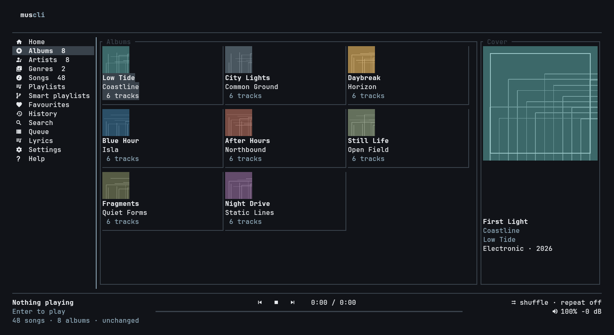

# muscli

[](https://github.com/Kumpelo/muscli/actions/workflows/ci.yml)
[](https://github.com/Kumpelo/muscli/releases)
[](LICENSE)

A local music player for Linux and Windows, with a terminal interface,
local folders and removable-drive libraries. No account or streaming service.

[Español](docs/README.es.md) · [Install](#install) · [User guide](docs/usage.md)



*muscli 0.2.0-beta.3 · Sample library · Steel Blue palette.*

## Features

- Albums, artists, genres, search, playlists and saved queues.
- Gapless playback through mpv or the built-in audio backend.
- ReplayGain, an eight-band equalizer and optional bit-perfect output.
- Live MIX, adjustable pause fade and synchronized lyrics that work offline.
- Discord Rich Presence, Linux MPRIS and Windows media controls.
- Desktop themes, English/Spanish UI and optional Omarchy integration.

## Install

Current beta: **0.2.0-beta.5**. Download a package from
[Releases](https://github.com/Kumpelo/muscli/releases).
On Windows, run the `.exe` installer; mpv and FFmpeg are bundled. On Linux,
install ALSA, mpv and FFmpeg, then extract the archive and place `muscli` in
`~/.local/bin`.

| Linux distribution | Runtime dependencies |
|---|---|
| Arch / Omarchy | `sudo pacman -S alsa-lib mpv ffmpeg` |
| Debian | `sudo apt install libasound2 mpv ffmpeg` |
| Ubuntu 24.04+ | `sudo apt install libasound2t64 mpv ffmpeg` |

To build from a cloned checkout, install Rust 1.90+ and the ALSA development
headers on Linux, then run:

```bash
cargo install --locked --root "$HOME/.local" --path .
```

See the [installation details](docs/usage.md#installation) for archive commands
and Omarchy setup. The Windows installer is unsigned; SmartScreen may request
confirmation.

## Quick start

```bash
muscli library add /path/to/Music
muscli library rescan
muscli
```

| Key | Action |
|---|---|
| Arrows / `hjkl` | Navigate |
| Enter / Esc | Open or play / go back |
| Space / `n` / `p` | Pause or resume / next / previous |
| `/` / `x` | Search / song menu |
| `a` / `s` / `r` | Add to queue / shuffle / repeat |
| `+` / `-` | Volume |
| `,` / `?` / `q` | Settings / help / save and quit |

Use Settings to choose your audio backend, language, theme and playback
preferences. Run `muscli keys` for all bindings or `muscli doctor` to check setup.

## Documentation

- [User guide](docs/usage.md): library commands, audio, lyrics and configuration.
- [Álbumes, MIX y widget](docs/playback-and-widget.es.md): playback and the optional Omarchy widget, in Spanish.
- [Contributing](CONTRIBUTING.md) · [Security](SECURITY.md) · [Third-party notices](THIRD_PARTY_NOTICES.md)

muscli is in beta. Native gapless playback requires compatible track formats;
Opus now decodes natively; WavPack and Monkey's Audio use the mpv fallback. See the
[audio guide](docs/usage.md#audio) for the current limits.
